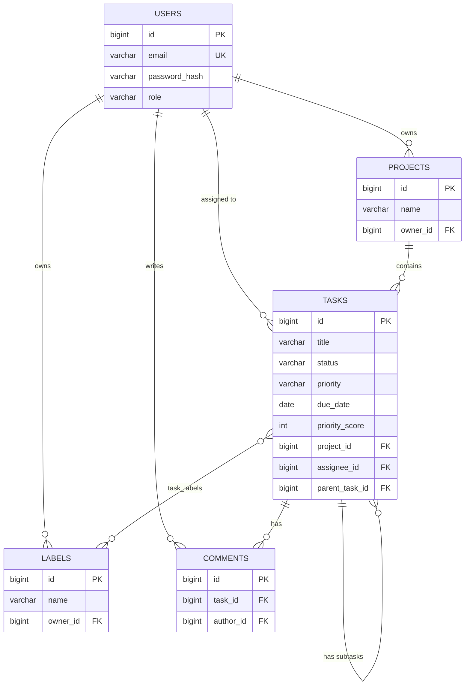

# Database structure (PostgreSQL)

Database: `stms_db` - user: `stms_user` - password: `stms_pass` (local development only).
The tables are created automatically by Flyway from `backend/task-service/src/main/resources/db/migration/V1__init_schema.sql`.

## ER diagram



## Tables

### users
| Column | Type | Notes |
|---|---|---|
| id | BIGSERIAL PK | |
| name | VARCHAR(100) | |
| email | VARCHAR(150) UNIQUE | stored lowercase, used as the login name |
| password_hash | VARCHAR(255) | BCrypt hash, never the plain password |
| role | VARCHAR(20) | `USER` or `ADMIN` |
| created_at | TIMESTAMP | |

### projects
| Column | Type | Notes |
|---|---|---|
| id | BIGSERIAL PK | |
| name | VARCHAR(150) | |
| description | TEXT | optional |
| owner_id | BIGINT FK -> users | `ON DELETE CASCADE` |
| created_at | TIMESTAMP | |

### tasks
| Column | Type | Notes |
|---|---|---|
| id | BIGSERIAL PK | |
| title | VARCHAR(200) | |
| description | TEXT | optional |
| status | VARCHAR(20) | `TODO`, `IN_PROGRESS`, `DONE` |
| priority | VARCHAR(20) | `LOW`, `MEDIUM`, `HIGH`, `URGENT` |
| recurrence | VARCHAR(20) | `NONE`, `DAILY`, `WEEKLY`, `MONTHLY` |
| due_date | DATE | optional |
| priority_score | INTEGER | smart score 0-100, computed by the backend |
| reminder_sent | BOOLEAN | prevents duplicate reminders |
| project_id | BIGINT FK -> projects | `ON DELETE CASCADE` |
| assignee_id | BIGINT FK -> users | `ON DELETE SET NULL` |
| parent_task_id | BIGINT FK -> tasks | non-null = subtask (self-reference) |
| created_at / updated_at / completed_at | TIMESTAMP | |

### labels
`id`, `name`, `color` (hex), `owner_id` FK -> users. Unique together: `(owner_id, name)`.

### task_labels (many-to-many link table)
`task_id` FK -> tasks, `label_id` FK -> labels, primary key `(task_id, label_id)`. Rows disappear automatically when either side is deleted.

### comments
`id`, `content`, `task_id` FK -> tasks, `author_id` FK -> users, `created_at`.

## Indexes
| Index | Why |
|---|---|
| `idx_tasks_project`, `idx_tasks_assignee`, `idx_tasks_parent` | fast joins and board loading |
| `idx_tasks_status_due` | reminder job and overdue/due-today dashboard counts |
| `idx_tasks_priority_score` | "Do these first" ordering |
| `idx_projects_owner`, `idx_comments_task` | per-owner and per-task lookups |

## Useful psql commands
```
psql -h localhost -U stms_user -d stms_db
\dt                                -- list tables
SELECT * FROM flyway_schema_history;
SELECT title, status, priority, priority_score FROM tasks ORDER BY priority_score DESC;
```
